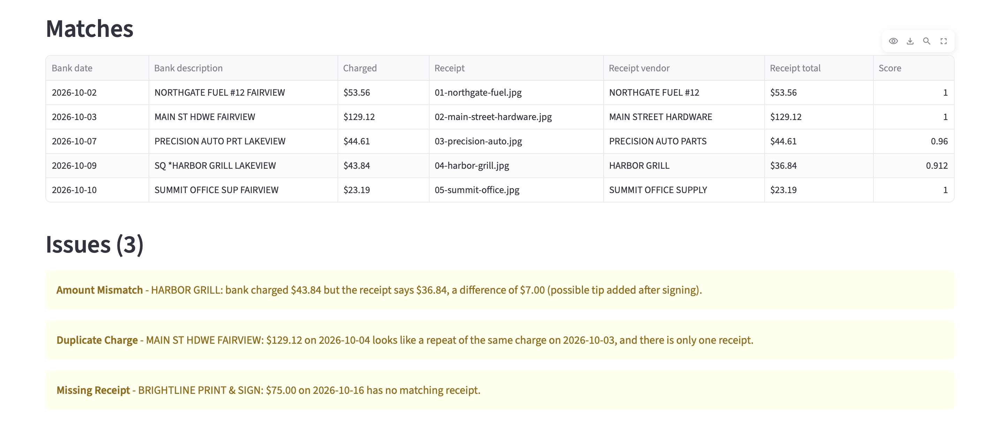
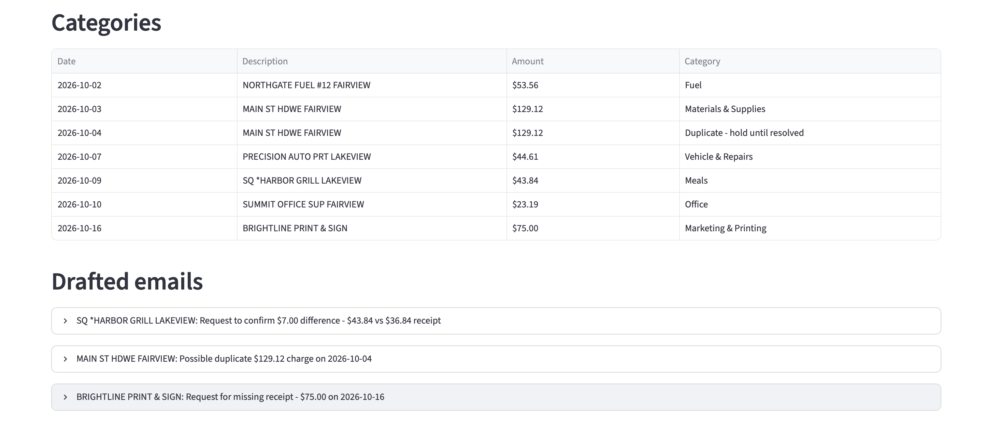
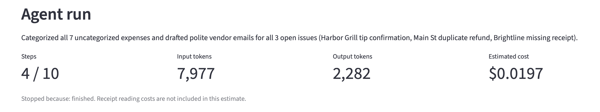

# Bookkeeping Agent

An AI bookkeeping agent for small businesses.

Matches bank charges to receipt photos, flags problems, then lets an AI agent
categorize expenses and draft emails to vendors.

## Setup

```bash
python3 -m venv .venv
source .venv/bin/activate
pip install -r requirements.txt
cp .env.example .env      # then put your Muse Spark key, base URL and model in .env
```

`.env` is in `.gitignore`, so your API key won't be committed.

## Run

```bash
streamlit run app.py      # open the page, upload samples/bank.csv and samples/receipts/*.jpg
pytest -v                 # run the tests (no API calls, no key needed)
```

## Results on the sample data

Using Muse Spark on the files in `samples/`:

- All 5 receipts are read correctly (vendor, date and total match `samples/ANSWER_KEY.md`).
- All 3 planted problems are caught: a duplicate Main St Hardware charge, a $7.00
  tip mismatch at Harbor Grill, and a missing Brightline Print & Sign receipt.
  The $2,400 deposit is correctly skipped.
- The agent finishes in 3-4 of its 10 steps for about $0.02.
- Reading the 5 receipts costs about $0.015 the first time. After that the results
  come from the cache and are free.

The receipts and bank statement in samples/ are made up. I created them to test the agent, and none of the businesses or transactions are real.

## Screenshots

**Matches and issues:** every receipt is paired with its bank charge, and the 3 problems are flagged.



**Categories and drafted emails:** the duplicate charge is held instead of being counted as an expense.



**Agent run:** steps used, tokens and estimated cost.



## How it works

| Step | File | Who does it |
|---|---|---|
| 1. Read the bank CSV, skip deposits | `bank.py` | Python |
| 2. Read each receipt photo (vendor, date, total) | `receipts.py` | Muse Spark model, cached by image hash in `receipt_cache.json` |
| 3. Score every charge/receipt pair and pick the best matches | `matching.py` | Python (difflib) |
| 4. Find missing receipts, amount mismatches, duplicates | `issues.py` | Python |
| 5. Categorize expenses and draft vendor emails | `agent.py` | Model chooses tools, Python runs them |
| 6. Show everything on a web page | `app.py` | Streamlit |

**Matching score** = 50% vendor-name similarity + 30% amount closeness + 20% date
closeness. Pairs more than 4 days apart score 0. Pairs need a score of at least
0.7 to match. Bank abbreviations like `HDWE` are expanded using the
`ABBREVIATIONS` table in `matching.py`. Add new ones there when you see them.

**Agent loop**: the model can call `get_unresolved_items`, `categorize_expense`,
`draft_vendor_email` and `finish`. It runs for at most 10 steps. Token usage is
added up after each step, and the cost is estimated at $1.25 per million input
tokens and $4.25 per million output tokens.

**Tests** use the correct receipt values from `samples/ANSWER_KEY.md` and a
`FakeModelClient` (`tests/fake_client.py`) that plays back scripted replies. That
way the agent loop is tested without calling the API.

## How I built this

I built this project with Claude Code, an AI coding assistant. I made the design decisions and checked the work: I chose to keep all matching and math in Python, created the test data with planted problems to verify the results, reviewed and tested each part, and fixed the issues I found along the way, including the security problems described below.

## What I learned

**Let code do the math.** Language models can get numbers wrong, so the model only reads the receipts. All of the matching, scoring and arithmetic happens in plain Python, where I can test it and trust the result.

**Real bank data is messy.** Banks often post a charge a day or two after the purchase, and they shorten store names, so "Main Street Hardware" shows up as "MAIN ST HDWE." I had to build the matching to allow for small date gaps and to compare names by similarity instead of looking for an exact match.

**API calls add up.** Every receipt sent to the model costs money, so I save each result using a fingerprint of the image. If the same receipt shows up again, the agent uses the saved answer instead of paying to read it twice.

**Think like a bookkeeper.** At first the agent counted a duplicate charge as two real expenses. A careful bookkeeper wouldn't, so now suspected duplicates are held until someone confirms them.

**Secrets leak in unexpected ways.** While I was setting up the project, a check meant to confirm my API key was saved ended up printing the key itself. I revoked that key right away, made a new one, and changed my checks so they only report whether a value is set, never what it is.

**A local app isn't always private.** By default, the app could be opened by other devices on the same Wi-Fi network, which meant someone else could run it on my API credit. I changed the settings so it only accepts connections from my own computer.
